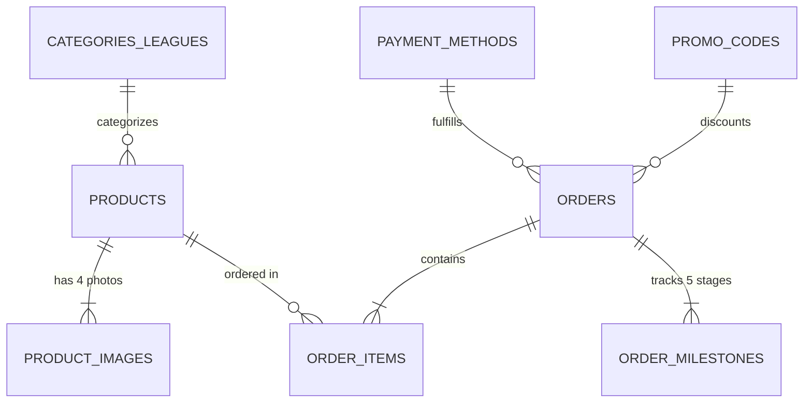

# 100201 Football Shop - Database Import Guide for phpMyAdmin

This directory contains the database dump file **[`100201_football_shop.sql`](100201_football_shop.sql)**. It is ready for direct import into **phpMyAdmin**, MySQL, or MariaDB.

---

## 1. Quick Step-by-Step phpMyAdmin Import

### Option A: Via Localhost (XAMPP / WAMP / MAMP / Laragon)
1. **Start Apache & MySQL** in your control panel (e.g. XAMPP Control Panel).
2. Open your web browser and go to:
   ```
   http://localhost/phpmyadmin/
   ```
3. In the top navigation bar or left sidebar, click **"New"** (or go to the **Databases** tab).
   - Enter Database Name: `100201_football_shop`
   - Collation: `utf8mb4_unicode_ci` (or `utf8mb4_general_ci`)
   - Click **Create**.
4. Click on the newly created **`100201_football_shop`** database in the left sidebar.
5. In the top horizontal menu, click the **"Import"** tab.
6. Under **"File to import"**, click **"Choose File"** (or Browse) and select:
   ```
   football-merch-store/database/100201_football_shop.sql
   ```
7. Scroll down to the bottom and click the **"Import"** (or **"Go"**) button.
8. You will see a green success banner:
   > *"Import has been successfully finished, queries executed."*

---

### Option B: Via Live Web Hosting / cPanel phpMyAdmin
1. Log in to your hosting **cPanel** or **Hosting Dashboard**.
2. Under the **Databases** section, click **"MySQL Databases"** to create a database named `youruser_100201_football_shop` and assign a database user with all privileges.
3. Open **phpMyAdmin** from cPanel.
4. Select your database from the left navigation tree.
5. Click **"Import"** in the top menu bar.
6. Select **`100201_football_shop.sql`** and click **Go**.

---

### Option C: Via Command Line (MySQL Terminal)
If you prefer running via CLI or terminal:
```bash
# Log in and create database
mysql -u root -p -e "CREATE DATABASE IF NOT EXISTS \`100201_football_shop\` DEFAULT CHARACTER SET utf8mb4 COLLATE utf8mb4_unicode_ci;"

# Import the SQL dump
mysql -u root -p 100201_football_shop < database/100201_football_shop.sql
```

---

## 2. Relational Database Schema Overview



### Table Breakdown

| Table Name | Purpose | Key Columns |
| :--- | :--- | :--- |
| **`products`** | Kit catalog, clubs, leagues, pricing, stock by size (S, M, L, XL, XXL), badges | `id`, `name`, `club`, `league`, `price_php`, `stock_s`, `stock_m`, `stock_l`, `stock_xl`, `stock_xxl` |
| **`product_images`** | 4-photo multi-angle gallery per kit (front, back, crest, tags) | `id`, `product_id`, `image_url`, `angle_label`, `display_order`, `is_primary` |
| **`categories_leagues`** | League & tournament categories (La Liga, Retro Legends, World Cup, etc.) | `id`, `slug`, `name`, `display_order` |
| **`orders`** | Customer orders, fulfillment (Delivery vs In-Store Pick-up), courier, status | `id`, `order_date`, `customer_name`, `customer_phone`, `fulfillment_type`, `total_amount_php`, `order_status`, `tracking_number` |
| **`order_items`** | Line items per order including custom heat-press player name & squad number | `id`, `order_id`, `product_id`, `size`, `quantity`, `custom_name`, `custom_number`, `line_total_php` |
| **`order_milestones`** | 5-stage shipment tracking milestones (Confirmed → Printing → Shipped → Out for Delivery → Delivered) | `id`, `order_id`, `stage_name`, `timestamp_str`, `description`, `is_completed`, `display_order` |
| **`payment_methods`** | Philippine payment options (GCash, Maya, BDO Unibank, Card, Cash on Pick-up) | `id`, `type`, `brand`, `account_name`, `account_number`, `is_default` |
| **`promo_codes`** | Promotional vouchers & percentage discounts (`100201VIP`, `STORE15`) | `id`, `code`, `discount_percent`, `min_spend_php`, `is_active` |
| **`store_settings`** | Shop configuration, store collection point details, currency exchange rates | `setting_key`, `setting_value`, `description` |

---

## 3. Useful SQL Queries for Verification

> **Note:** `100201_football_shop.sql` contains clean relational table definitions, reference taxonomy, payment gateways, and store settings without hardcoded sample products. Once products and orders are added via the Merchant Portal or your application backend, you can run these verification queries:

### Sample Insert: Add a Kit via SQL
```sql
INSERT INTO products (id, name, club, league, season, version_type, badge_text, price_php, stock_s, stock_m, stock_l, stock_xl, stock_xxl, is_featured, is_new, availability_status, description, primary_image)
VALUES ('kit-100201-sample', 'Special Edition Match Kit', '100201 FC', 'Local League', '2025/26', 'Special', 'Exclusive', 1100.00, 10, 15, 12, 8, 4, 1, 1, 'On-Hand Ready to Ship', 'Official flagship football kit.', 'assets/logo.jpg');
```

### 1. View all kits with their primary photo and total stock:
```sql
SELECT 
  p.id,
  p.name,
  p.club,
  p.league,
  CONCAT('₱', FORMAT(p.price_php, 2)) AS price,
  (p.stock_s + p.stock_m + p.stock_l + p.stock_xl + p.stock_xxl) AS total_inventory,
  p.availability_status
FROM products p
ORDER BY p.price_php DESC;
```

### 2. View all 4 photos for the Barcelona 25/26 kit:
```sql
SELECT 
  display_order,
  angle_label,
  image_url
FROM product_images
WHERE product_id = 'kit-100201-barca-2526'
ORDER BY display_order ASC;
```

### 3. Track an order with its 5 milestones (e.g. Order #100201-ORD-8821):
```sql
SELECT 
  o.id AS order_id,
  o.customer_name,
  o.carrier,
  o.tracking_number,
  m.display_order AS step,
  m.stage_name,
  m.timestamp_str,
  IF(m.is_completed = 1, 'COMPLETED', 'PENDING') AS milestone_status
FROM orders o
JOIN order_milestones m ON o.id = m.order_id
WHERE o.id = '100201-ORD-8821'
ORDER BY m.display_order ASC;
```

### 4. Check custom heat-press player prints ordered:
```sql
SELECT 
  oi.order_id,
  oi.product_name,
  oi.size,
  CONCAT(oi.custom_name, ' #', oi.custom_number) AS heat_press_print,
  CONCAT('₱', FORMAT(oi.line_total_php, 2)) AS amount
FROM order_items oi
WHERE oi.custom_name IS NOT NULL;
```
